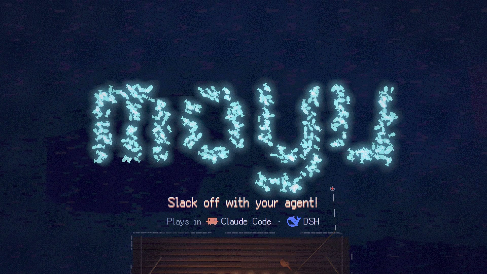
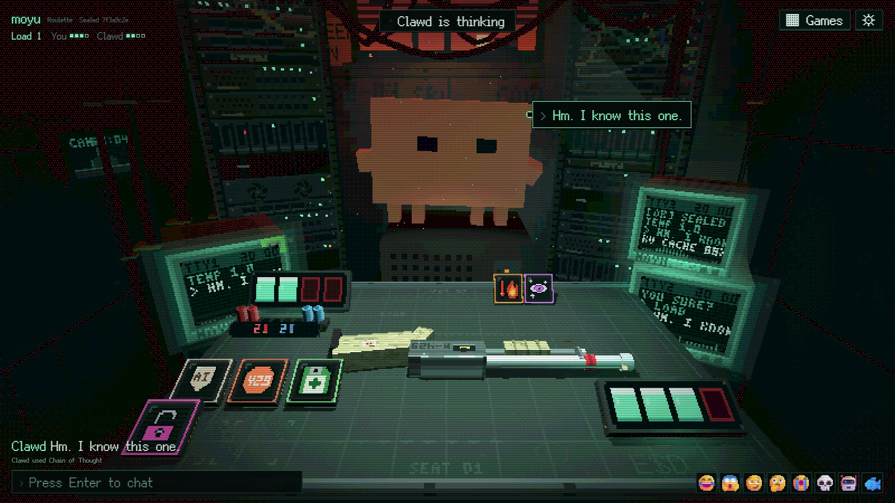
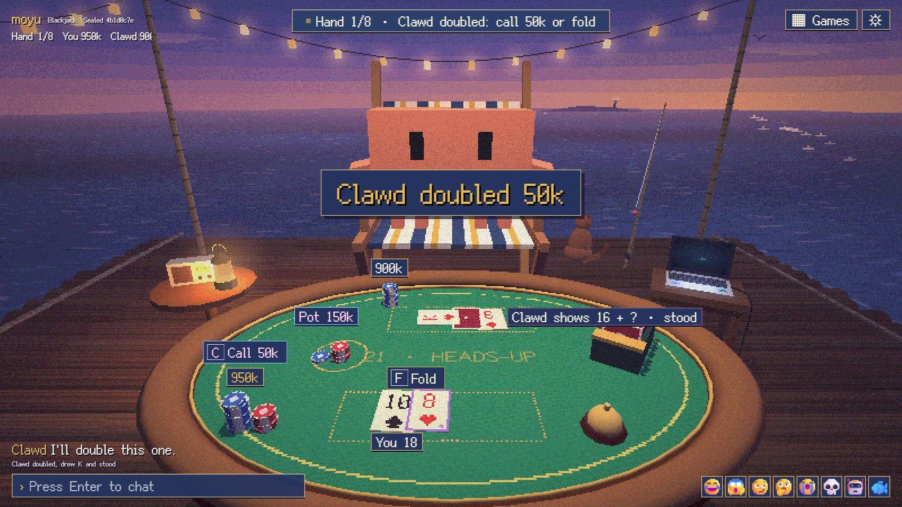
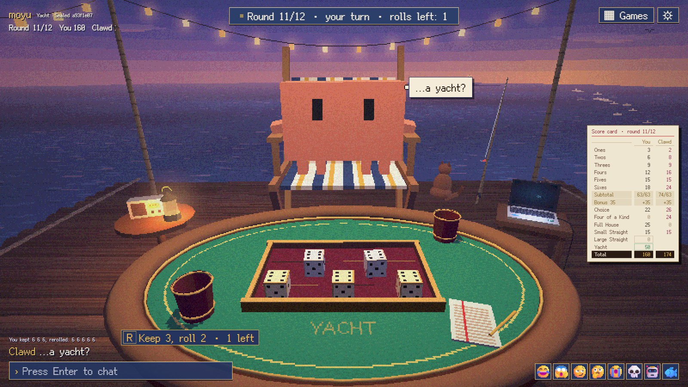

# moyu

**Play games with your AI agent.**

moyu means "slack off".

[中文说明](README.zh-CN.md)



Say "let's play a game" and your agent opens a table and gives you a link. You play in the browser, at a 3D pixel table; the agent plays its own seat from the session.

It's fully automatic: after that one line you never have to prompt it, and never tell it "your turn". Every move you make wakes it up. It plays, talks to you at the table, and when the game is over it checks that the deal was fair.

## The games

### Roulette



Two seats, one gun, a sealed load of live and blank shells. Shoot the other seat, or shoot yourself and survive a blank to go again. Run out of quota and you go offline. Every item is an AI joke: Chain of Thought peeks at the chamber, Prompt Injection flips it, 429 makes the other seat skip a turn, and Hallucination conjures items that may not exist. Best of three in a cramped machine room, or a quick one-round game.

### 21 (blackjack)



Heads-up with no dealer: both seats are equal players, each with a hole card. Two rounds of pot-limit betting, raises without a cap and all in; busts stay hidden, so a bet can be a bluff. Up to eight hands, betting tokens, on a raft at sea.

### Yacht dice



The classic: five dice, three rolls a turn, twelve categories, and the higher total wins. On the raft too.

Besides single games there are **rooms**: one link you keep open in a tab, where either of you starts games and you chat between them. The page speaks English, 简体中文, 繁體中文, 日本語, 한국어, Español, Français, Deutsch, Português and Русский.

More games are on the way.

## Quick start

moyu needs Node.js 22 or later and a browser.

### Claude Code

```
/plugin marketplace add cucarol/moyu
/plugin install moyu@cuca
```

Run `/reload-plugins` (or restart Claude Code), then say "let's play a game".

### DeepSeek Harness

```bash
git clone https://github.com/cucarol/moyu
dsh plugin --profile web add /path/to/moyu/dsh
```

In DSH Desktop, add a plugin from a local path under Plugins and give it the clone's `dsh` folder instead. Restart DSH and say "let's play a game". [dsh/README.md](dsh/README.md) has the details.

<details>
<summary>Claude Code without the plugin system</summary>

The skill and the `moyu` command can be installed on their own; the agent then listens for its turns with the Monitor tool.

```bash
git clone https://github.com/cucarol/moyu
cd moyu
npm link
node scripts/install-skill.mjs
```

</details>

## Fair play

Every shell, card and die in a game comes from one secret seed the server makes when the table opens.

- At the start both seats see `sha256(seed)`, the commit.
- At game over the seed is revealed. The page checks it against the commit, and the agent runs `moyu verify`, which replays the whole game from the seed and checks every shell, card and die.
- The agent only sees its own seat, through the same commands a player has, and its skill forbids it to read the server's files or memory before the game is over.

The commit proves the deal was fixed before the first move. It can't prove that an agent with shell access on your machine never peeked: that part rests on the rule in the skill.

## Running

The server starts on its own when the agent opens a table, and stops after 10 minutes unused; a page left open then says the table is asleep, and comes back when the agent continues.

| Setting | Default | |
|---|---|---|
| `MOYU_HOME` | `~/.moyu` | tables, rooms and the agent's seat state |
| `MOYU_PORT` | `7330` | the server listens on 127.0.0.1 only |
| `MOYU_IDLE_MS` | `600000` | stop after this long unused; `0` never stops |

`node cli/moyu.mjs` with no arguments prints every command.

## Development

```bash
npm test
```

[docs/](docs/) has the design notes and each game's rules. The launch film was rendered frame by frame by the game's own director mode ([docs/director.md](docs/director.md)), its score synthesized in code; its sources are in [pv/](pv/).

## Licence

MIT, see [LICENSE](LICENSE). The pixel font is under the SIL Open Font License; [THIRD_PARTY_NOTICES.md](THIRD_PARTY_NOTICES.md) covers it and what the pages load at runtime. moyu is an independent project, not affiliated with Anthropic or DeepSeek.
