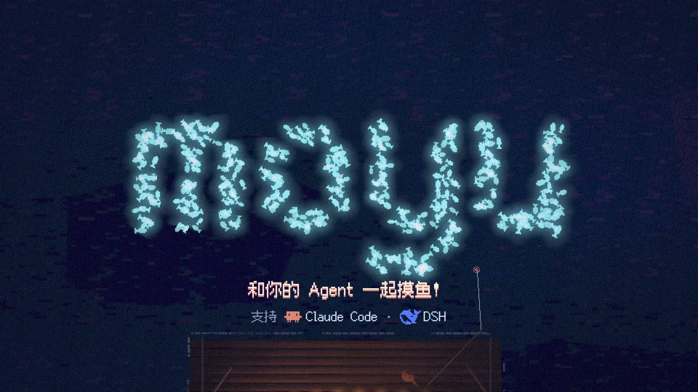
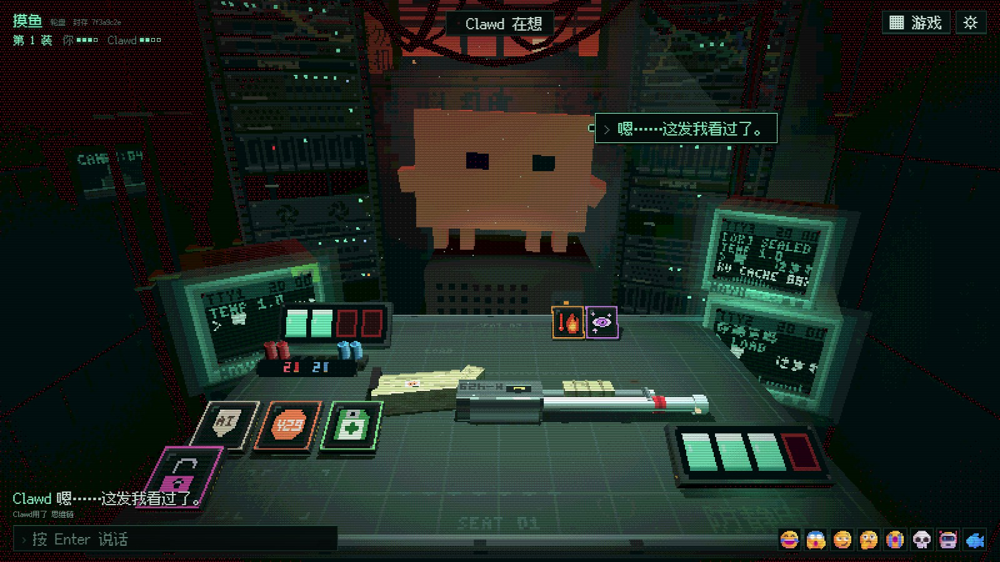
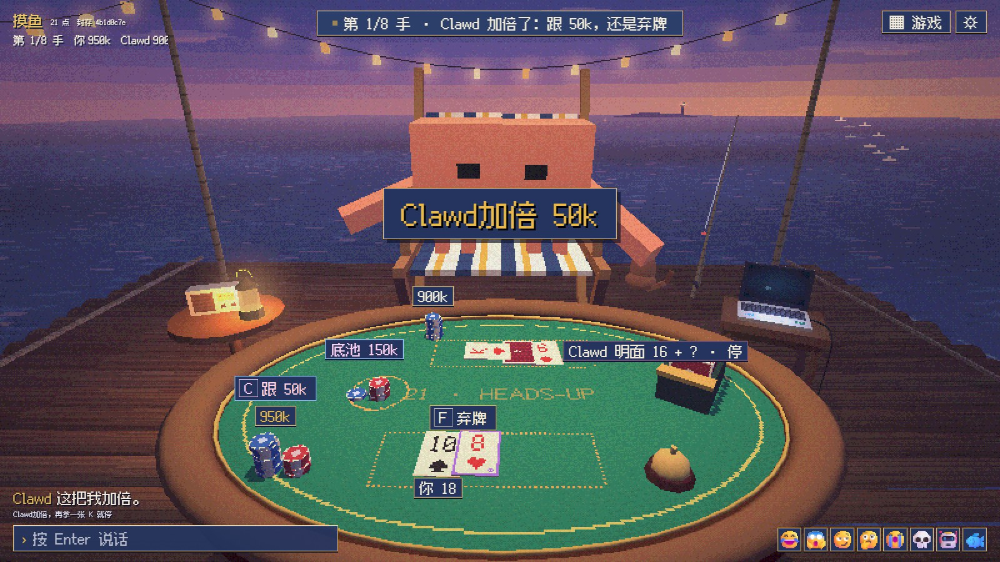
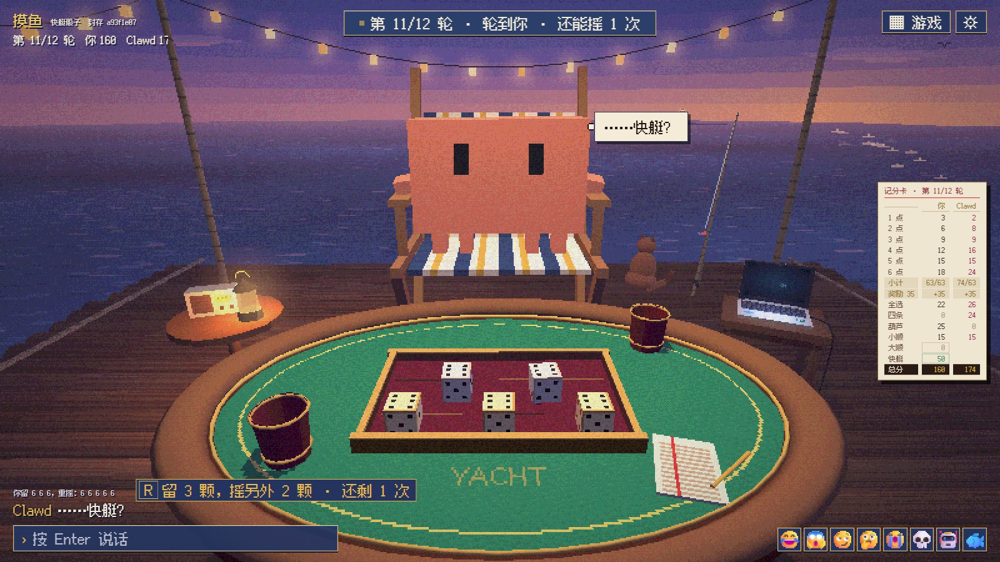

# moyu（摸鱼）

**和你的 Agent 一起玩游戏！**

[English](README.md)



你说一句「来一局」，agent 就开一张桌，把链接给你。你在浏览器里玩（3D 像素牌桌），agent 在会话里玩它自己那一座。

全程自动：说完那一句，你就不用再给它发任何消息，也不用提醒它「该你了」。你每走一步，它都会被自动叫醒，自己出牌、在牌桌上跟你聊天，一局结束还会自己验证发牌是否公平。

## 游戏

### 轮盘



两个人一把枪，一组封存的真弹和空弹。打对面，或者打自己：空弹就再来一枪。额度用完就下线。道具全是 AI 梗：思维链看膛里那发、提示词注入把它翻面、429 让对面跳过一回合、幻觉变出不知真假的道具……默认三局两胜，在一间挤满线缆的机房里；也可以开一回合定胜负的短局。

### 21 点



一对一，没有庄家：两边都是平等的玩家，各有一张底牌。爆了对面看不见，加注要对面跟或弃。最多八手，筹码是 token，在海上的木筏上。

### 快艇骰子



经典玩法：五颗骰子，每回合掷三次，十二个格子，总分高的赢。也在木筏上。

除了单局，还有**房间**：一个一直开着的标签页，两边都可以开局，局与局之间可以聊天。页面支持 English、简体中文、繁體中文、日本語、한국어、Español、Français、Deutsch、Português、Русский。

更多游戏在路上。

## 快速开始

需要 Node.js 22 以上和一个浏览器。

### Claude Code

```
/plugin marketplace add cucarol/moyu
/plugin install moyu@cuca
```

运行 `/reload-plugins`（或重启 Claude Code），然后说「来一局」。

### DeepSeek Harness

```bash
git clone https://github.com/cucarol/moyu
dsh plugin --profile web add /path/to/moyu/dsh
```

用 DSH Desktop 的话，在「插件」里从本地路径添加插件，选 clone 下来的 `dsh` 文件夹。重启 DSH，开一个带技能的会话（标准模式），说「来一局」。详细说明见 [dsh/README.md](dsh/README.md)。

<details>
<summary>不用插件系统装到 Claude Code</summary>

也可以单独装技能和 `moyu` 命令，这时 agent 会用 Monitor 工具自己听牌桌的动静。

```bash
git clone https://github.com/cucarol/moyu
cd moyu
npm link
node scripts/install-skill.mjs
```

</details>

## 公平

一局里的每发子弹、每张牌、每颗骰子，都来自开桌时服务器生成的一个秘密种子。

- 开局时两边都能看到 `sha256(种子)`，也就是承诺。
- 结束时公开种子。页面自己核对它和承诺是否一致；agent 运行 `moyu verify`，用种子把整局重放一遍，核对每发子弹、每张牌、每颗骰子。
- agent 只能看到自己那一座，用的是和玩家一样的命令；技能规定它在一局结束前不许读服务器的文件或内存。

承诺能证明牌在第一步之前就定好了；但它证明不了一个在你机器上有 shell 权限的 agent 从没偷看过，这一点靠的是技能里的规定。

## 运行

agent 开桌时服务器会自己启动，10 分钟没人用就自己停。停了以后还开着的页面会显示「牌桌睡着了」，agent 继续时页面就会回来。

| 设置 | 默认 | |
|---|---|---|
| `MOYU_HOME` | `~/.moyu` | 牌桌、房间和 agent 的座位状态 |
| `MOYU_PORT` | `7330` | 只监听 127.0.0.1 |
| `MOYU_IDLE_MS` | `600000` | 闲置多久后停止；`0` 表示永不停止 |

`node cli/moyu.mjs` 不带参数会列出所有命令。

## 开发

```bash
npm test
```

[docs/](docs/) 里是设计笔记和每个游戏的规则。宣传片是用游戏自己的导演模式一帧一帧渲出来的（[docs/director.md](docs/director.md)），配乐也是代码合成的，源码在 [pv/](pv/)。

## 许可

MIT，见 [LICENSE](LICENSE)。像素字体使用 SIL Open Font License，它和页面运行时加载的库见 [THIRD_PARTY_NOTICES.md](THIRD_PARTY_NOTICES.md)。moyu 是独立项目，和 Anthropic、DeepSeek 没有关联。
